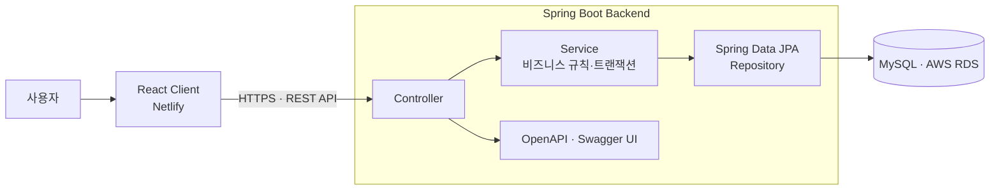

<div align="center">

# SportMatch Backend

### 지역 기반 아마추어 스포츠 팀 구성·매칭 플랫폼

회원 관리 · 팀원/팀 모집 게시판 · 팀 운영 · 팀 간 경기 매칭


[프로젝트 개요](#프로젝트-개요) · [담당 업무](#담당-업무) · [주요 기능](#주요-기능) · [설계와 구현](#설계와-구현) · [실행 방법](#실행-방법)

</div>

## 프로젝트 개요

**SportMatch는 같은 지역에서 스포츠를 즐길 사용자들이 팀을 만들고, 팀원을 모집하며, 팀 간 경기를 연결할 수 있도록 만든 웹 서비스입니다.** 소프트웨어공학 팀 프로젝트로 진행했으며 이 저장소는 백엔드 구현과 개발 이력을 개인 포트폴리오 형태로 정리한 저장소입니다.

Spring Boot REST API와 React 클라이언트를 분리해 개발했습니다. 사용자는 회원가입 후 팀원·팀·경기 모집 게시판을 이용하고, 팀 생성과 가입, 팀장 권한 양도, 공지 작성, 경기 매칭까지 하나의 흐름으로 진행할 수 있습니다.

| 항목 | 내용 |
| --- | --- |
| 프로젝트 형태 | 소프트웨어공학 팀 프로젝트 |
| 개발 기간 | 2024.11 ~ 2024.12 |
| 담당 역할 | Backend |
| 구현 범위 | 회원, 게시판, 댓글, 즐겨찾기, 팀 관리, 경기 매칭, 문의 REST API |
| 팀 저장소 | [Backend](https://github.com/SW-Engneering/SW-backend) · [Frontend](https://github.com/SW-Engneering/SW-client) |

## 담당 업무

- Spring Boot·Spring Data JPA·MySQL 기반 백엔드 프로젝트 구조 및 데이터베이스 연동
- 팀원 구하기·팀 구하기 게시판 작성, 목록·상세 조회, 수정, 삭제 API 구현
- 댓글 CRUD와 작성자 권한 검사, 댓글 수 동기화 및 예외 처리
- 팀 생성·조회·수정·삭제, 팀원 추가·방출·탈퇴, 팀장 권한 양도 흐름 구현
- 팀 간 경기 매칭 기능 통합 및 인원 조건·중복 팀/중복 매칭 검증
- 팀 활동 지역, 한국 시간대, CORS 및 배포 환경 연동 설정

## 주요 기능

| 기능 | 사용자 흐름 | 백엔드 구현 |
| --- | --- | --- |
| 회원 관리 | 가입 → 로그인 → 프로필 조회·수정 → 탈퇴 | 닉네임 중복 검사, 회원 CRUD, 팀장 탈퇴 제한과 연관 데이터 정리 |
| 모집 게시판 | 팀원/팀/경기 모집 글 작성 → 목록·상세 확인 | 게시판 유형별 조회, 조회 수, 작성자 기반 수정·삭제 권한 검사 |
| 댓글·즐겨찾기 | 게시글에 댓글 작성·수정·삭제, 관심 글 저장 | 댓글 수 증감, 작성자 검증, 중복 즐겨찾기 방지 |
| 팀 관리 | 팀 생성 → 팀원 추가 → 역할 관리 → 공지 확인 | 팀장/팀원 역할, 팀장 양도, 방출·탈퇴, 팀 정보와 공지 관리 |
| 경기 매칭 | 두 팀 선택 → 날짜·장소 등록 → 경기 관리 | 양 팀 11명 이상 확인, 참여 중인 팀의 중복 매칭 방지, 경기 CRUD |
| 문의 | 문의 작성 → 내 문의 조회·삭제 | 사용자별 문의 저장과 조회 |

## 기술 스택

| 구분 | 기술 | 사용 목적 |
| --- | --- | --- |
| Language | Java 17 | 백엔드 애플리케이션 구현 |
| Framework | Spring Boot 3.3.5, Spring Web | REST API와 HTTP 요청·응답 처리 |
| Persistence | Spring Data JPA, Hibernate | 엔티티 매핑, 연관관계와 트랜잭션 관리 |
| Database | MySQL | 회원·게시글·팀·경기 데이터 저장 |
| API Docs | springdoc-openapi 2.5.0, Swagger UI | API 명세 확인과 요청 테스트 |
| Build / Test | Gradle Wrapper, JUnit 5 | 의존성 관리, 빌드와 테스트 |
| Deployment | HTTPS, AWS EC2·RDS | 백엔드 서버와 운영 데이터베이스 구성 |

## 시스템 구조



요청은 Controller에서 DTO로 받고, Service에서 권한·중복·상태 조건을 검사한 뒤 Repository를 통해 MySQL에 저장합니다. 팀원 변경처럼 여러 엔티티를 함께 갱신하는 작업은 트랜잭션 단위로 처리합니다.

## 설계와 구현

### 1. 팀 생명주기와 사용자 소속을 함께 관리

팀을 만들면 생성자를 팀장으로 등록하고 사용자에게 팀을 연결합니다. 팀원 추가·방출·탈퇴 때는 `TeamMember` 관계와 사용자의 `team` 값을 함께 변경해 양쪽 상태가 어긋나지 않도록 했습니다.

- 이미 팀에 가입한 사용자의 중복 가입 차단
- 팀장만 팀 정보 수정·팀원 방출·공지 작성 가능
- 팀장 권한 양도 시 기존 팀장과 새 팀장의 역할을 함께 변경
- 남아 있는 팀원이 있으면 팀 삭제를 거부하고, 삭제 시 공지·매칭 관계 정리

구현: [`TeamService`](src/main/java/com/swengineer/sportsmatch/service/TeamService.java) · [`TeamController`](src/main/java/com/swengineer/sportsmatch/controller/TeamController.java)

### 2. 경기 생성 전에 팀 상태 검증

경기 매칭을 생성하기 전에 홈팀과 원정팀의 존재 여부, 각 팀의 인원, 기존 매칭 참여 여부를 순서대로 확인합니다. 조건을 만족하지 않으면 HTTP 상태와 원인을 반환하고, 검증을 통과한 경우에만 날짜와 장소를 저장합니다.

```text
두 팀 조회 → 팀별 11명 이상 확인 → 기존 매칭 여부 확인 → 경기 저장
```

구현: [`MatchService`](src/main/java/com/swengineer/sportsmatch/service/MatchService.java) · [`MatchRepository`](src/main/java/com/swengineer/sportsmatch/repository/MatchRepository.java)

### 3. 게시글과 댓글의 권한·집계 처리

팀원 구하기, 팀 구하기, 경기 모집 글을 하나의 게시글 모델에서 유형으로 구분했습니다. 상세 조회 시 조회 수를 반영하고, 글과 댓글의 수정·삭제는 작성자 ID가 일치할 때만 허용합니다. 댓글 작성·삭제 시 게시글의 댓글 수도 함께 갱신합니다.

구현: [`BoardService`](src/main/java/com/swengineer/sportsmatch/service/BoardService.java) · [`CommentService`](src/main/java/com/swengineer/sportsmatch/service/CommentService.java)

## API 구성

| 도메인 | 주요 경로 | 기능 |
| --- | --- | --- |
| User | `/user` | 가입, 로그인, 회원 목록·상세·수정·삭제 |
| Board | `/member`, `/team`, `/match`, `/post` | 유형별 게시글 CRUD와 사용자별 작성 글 조회 |
| Comment | `/comments` | 게시글 댓글 CRUD |
| Bookmark | `/bookmarks` | 즐겨찾기 추가·삭제·목록 조회 |
| Team | `/teams` | 팀 CRUD, 팀원·팀장·공지 관리 |
| Match | `/matches` | 경기 생성·조회·수정·삭제 |
| Inquiry | `/myPage/inquiry` | 사용자 문의 작성·조회·삭제 |

애플리케이션 실행 후 설정된 Swagger UI 경로에서 요청 형식과 전체 엔드포인트를 확인할 수 있습니다.

## 프로젝트 구조

```text
src/main/java/com/swengineer/sportsmatch/
├── config/       CORS와 HTTP/HTTPS 설정
├── controller/   REST API 엔드포인트
├── dto/          요청·응답 데이터 객체
├── entity/       JPA 엔티티와 연관관계
├── repository/   Spring Data JPA 저장소
└── service/      도메인 규칙과 트랜잭션

src/main/resources/   애플리케이션 설정
mysql/                테이블별 SQL 참고 파일
```

## 실행 방법

JDK 17과 MySQL이 필요합니다. 비밀번호 같은 개인 설정은 저장소에 추가하지 말고 환경 변수로 주입합니다. 아래는 Windows PowerShell 기준입니다.

```powershell
git clone https://github.com/js05157/SoftWareEngineering-Back.git
cd SoftWareEngineering-Back
git switch merge-branch

$env:SPRING_DATASOURCE_URL="jdbc:mysql://localhost:3306/sportsmatch?serverTimezone=Asia/Seoul&characterEncoding=UTF-8"
$env:SPRING_DATASOURCE_USERNAME="YOUR_MYSQL_USERNAME"
$env:SPRING_DATASOURCE_PASSWORD="YOUR_MYSQL_PASSWORD"
$env:SERVER_SSL_ENABLED="false"
$env:SERVER_PORT="8080"

.\gradlew.bat bootRun
```

로컬 실행 시 API 서버는 `http://localhost:8080`에서 확인할 수 있습니다. 테스트는 같은 데이터베이스 설정을 주입한 뒤 `.\gradlew.bat test`로 실행합니다.
